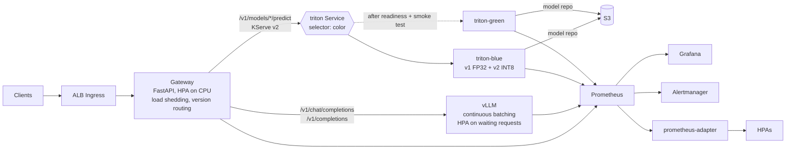

# High-Throughput ML Inference Platform

One gateway in front of two serving engines: **vLLM** for LLM token generation and **Triton Inference Server** for everything else. Kubernetes manifests cover GPU autoscaling on queue depth and blue/green model rollouts that only shift traffic after readiness probes pass. The tabular models ship as INT8-quantized ONNX next to their FP32 originals, so both versions can be served and compared live.

## Architecture



**Why two engines?** LLM decoding and tabular scoring want opposite things. vLLM's continuous batching and PagedAttention keep a GPU busy across many concurrent generations of different lengths. Triton's dynamic batcher merges single-row requests into GPU-sized batches within a configurable delay (500 µs here). Forcing one engine to do both leaves throughput on the table.

**Gateway** (`gateway/app`). Clients see one API. It routes to the right backend, picks a model version per request (pinned with `?version=`, or by a weighted `TRAFFIC_SPLIT` for canaries), and stamps the serving version in an `x-model-version` header and in metrics. When more than `MAX_IN_FLIGHT` requests are being processed it sheds load with a `429` and `Retry-After`, so overload fails fast instead of piling up timeouts while autoscaling catches up. Without `TRITON_URL` it runs the same ONNX files in-process, which is how tests and local benchmarks run.

**Autoscaling.** GPU pods can be saturated while their CPU looks idle, so Triton and vLLM scale on queueing, not CPU. Triton scales on average queue time per request; vLLM scales on requests waiting for a batch slot. `prometheus-adapter` exposes both as custom metrics. Scale-up is immediate; scale-down waits 5–10 minutes to avoid flapping.

**Blue/green** (`scripts/blue_green.sh`). The new colour is applied next to the live one. Triton runs with `--strict-readiness`, so a pod is not ready until every model has loaded and run its warm-up batch. The script waits for every pod to pass readiness, smoke-tests each model through the new colour's own Service, and only then flips the live Service's selector. The old colour stays at one replica (its HPA floor lowered so it does not scale back up), and `./scripts/blue_green.sh rollback` restores it.

## Results

All numbers below were measured on a 2 vCPU x86 machine without a GPU. GPU numbers have to come from your own cluster run; see *What still needs a GPU*.

### INT8 quantization (ONNX Runtime dynamic quantization, CPU, 1 thread)

| Model | Size | F1 FP32 → INT8 | Same prediction | p99, batch 1 | Rows/s, batch 256 |
|---|---|---|---|---|---|
| digits_mlp | 0.67 → 0.18 MB (3.8×) | 0.9719 → 0.9719 | 360 / 360 | 46 → 53 µs | 343k → 750k (2.2×) |
| fraud_mlp | 1.66 → 0.43 MB (3.9×) | 0.9293 → 0.9287 | 23,999 / 24,000 | 103 → 59 µs | 145k → 564k (3.9×) |
| risk_mlp | 0.17 → 0.05 MB (3.5×) | 0.9452 → 0.9452 | 114 / 114 | 32 → 34 µs | 1.18M → 1.66M (1.4×) |

Weights shrink about 3.8×, and accuracy moves by at most 0.06 F1 points (one changed prediction in 24,000). The speed-up grows with model size: the biggest MLP gains most at batch 256, while for the tiniest model a single request is dominated by fixed overhead and INT8 is no faster. Batched speed-ups vary by roughly ±0.5× between runs on a shared machine. Static (calibrated QDQ) quantization is also supported (`--mode static`); here it lost slightly more accuracy (up to 0.29 points) for no consistent speed gain, so dynamic is the default.

### Gateway throughput (in-process ONNX Runtime, 2 uvicorn workers, single-row requests)

| Concurrency | Throughput | p50 | p95 | p99 | Errors |
|---|---|---|---|---|---|
| 1 | 1,274 req/s | 0.75 ms | 1.14 ms | 1.47 ms | 0 |
| 16 | 3,063 req/s | 4.6 ms | 8.9 ms | 12.6 ms | 0 |
| 64 | 3,387 req/s | 16.7 ms | 28.3 ms | 40.5 ms | 0 |
| 256 | 2,921 req/s | 64.6 ms | 102 ms | 128 ms | 0 |

20,000 requests per level, and the load generator ran on the same two cores. Throughput peaks around 64 concurrent connections. Beyond that, requests queue and latency grows linearly, which is exactly the signal the HPA scales on.

Two findings from getting these numbers:

- **A 40 ms floor that was not the model.** The first runs showed about 44 ms per request for a 30 µs model. The server was writing response headers and body in separate TCP segments (uvicorn's pure-Python h11 fallback), and Nagle's algorithm plus the client's delayed ACK added about 40 ms to each one. Installing `uvicorn[standard]` (httptools + uvloop) fixed it, and the load generator now sends each request in one write with `TCP_NODELAY`.
- **Middleware cost.** The load shedder started as `@app.middleware("http")`. Starlette's `BaseHTTPMiddleware` re-wraps every response as a stream and releases the slot before a streamed LLM response finishes. It is now raw ASGI and holds the slot until the last byte is sent.

### What still needs a GPU

These pieces are written and configured but were not run here, because they need NVIDIA hardware:

- vLLM serving (`k8s/vllm`, compose profile `gpu`)
- Triton with TensorRT acceleration (`model_repository/*/config.pbtxt`)
- GPU memory per node, GPU instance counts, and cost

To get those numbers, deploy to EKS (`deploy/eks/README.md`) and run the Locust soak test, for example 30 minutes at 4,000 users:

```bash
locust -f loadtest/locustfile.py --host http://<gateway> --headless \
  --users 4000 --spawn-rate 200 --run-time 30m --processes -1 --csv loadtest/soak
```

Take latency percentiles from `loadtest/soak_stats.csv` and GPU memory from the Triton metric `nv_gpu_memory_used_bytes` in Grafana.

One caveat on INT8 and GPUs: ONNX Runtime's dynamic quantization emits integer MatMul ops that are a CPU optimisation. For INT8 on a GPU, use `--mode static` (QDQ format) and set TensorRT's `precision_mode` to `INT8` in the model config.

## Running it

```bash
pip install -r requirements-dev.txt
make models quantize     # train 3 MLPs → ONNX v1 (FP32), quantize → v2 (INT8)
make bench               # the quantization table above
make test                # 9 tests: gateway, Triton/vLLM protocol, quantization
make gateway             # API on :8080, models in-process
make loadtest            # the throughput table above
```

```bash
curl -s localhost:8080/v1/models/fraud_mlp/predict?version=1 \
  -H 'content-type: application/json' \
  -d '{"instances": [[0.1, -1.2, 0.5, 0.3, 1.1, -0.4, 0.0, 0.9, -0.7, 0.2, 0.6, -1.0, 0.4, 0.8, -0.3, 1.3, -0.9, 0.1, 0.7, -0.6, 0.2, 0.5, -0.8, 1.0, 0.3, -0.2, 0.6, -1.1, 0.9, 0.4, -0.5, 0.0, 1.2, -0.3, 0.8, -0.7, 0.1, 0.6, -0.4, 0.2]]}'
```

Full local stack (Triton on CPU, gateway, Prometheus, Grafana at :3000 with the dashboard pre-loaded):

```bash
make up                                   # CPU only
docker compose --profile gpu up --build   # adds vLLM if you have an NVIDIA GPU
```

## Layout

```
gateway/app/          FastAPI gateway: routing, version split, load shedding, metrics
models/               training + ONNX export
quantization/         INT8 quantization and FP32-vs-INT8 benchmark
model_repository/     Triton configs (dynamic batching, versions, warm-up, TensorRT)
k8s/triton/           blue/green deployment template, services, queue-based HPA, PDB
k8s/vllm/             vLLM deployment, shared weight cache on EFS, HPA on waiting requests
k8s/gateway/          gateway deployment, HPA, ALB ingress
k8s/monitoring/       ServiceMonitors, SLO alerts, prometheus-adapter rules
monitoring/           Grafana dashboard + local Prometheus config
deploy/eks/           eksctl cluster with CPU and GPU (g5) node groups
scripts/blue_green.sh zero-downtime rollout and rollback
loadtest/             Locust scenario and a raw-socket benchmark client
```

## License

MIT
